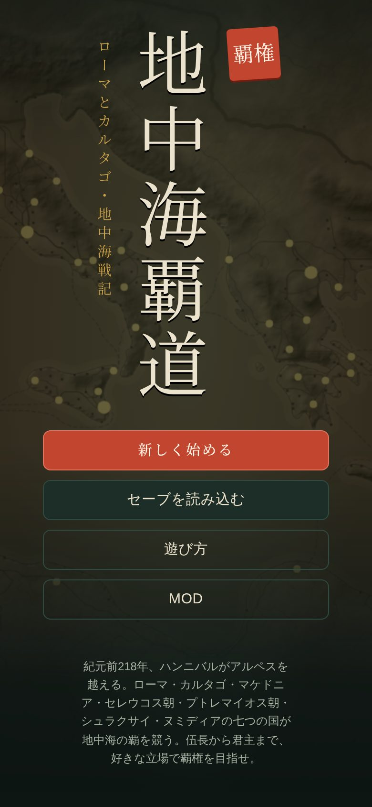
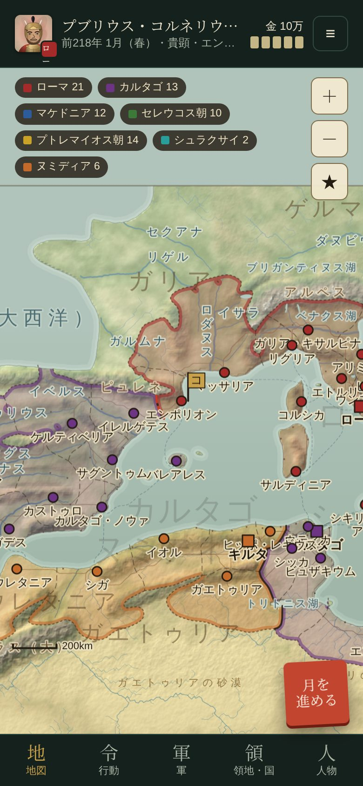
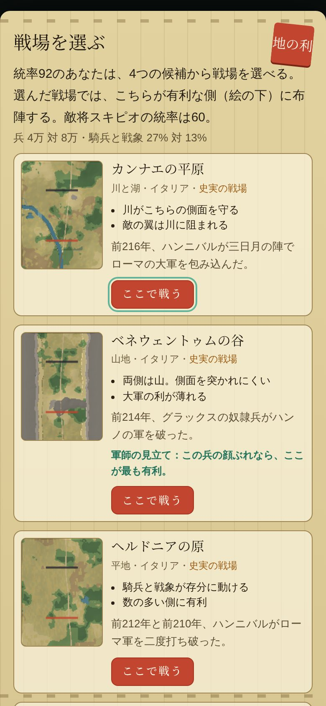
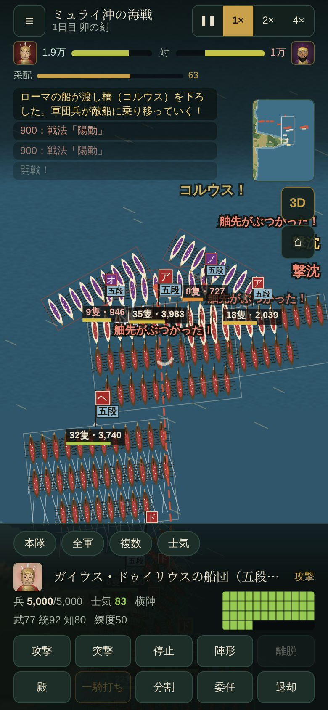
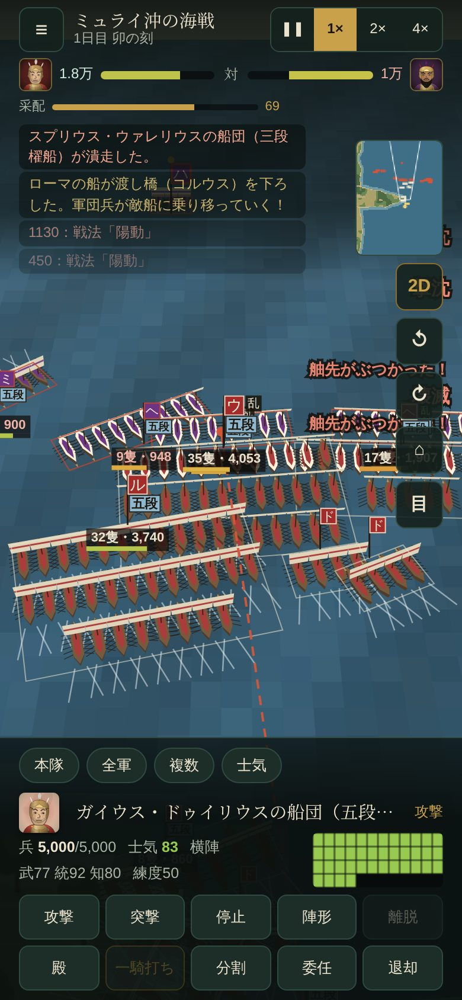
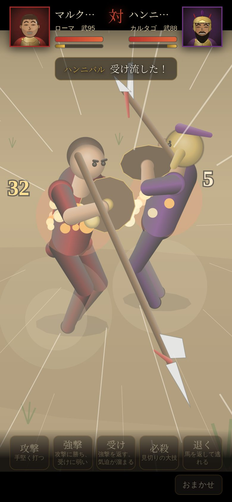

# 地中海覇道

紀元前218年、ハンニバルが戦象を連れてアルペス（アルプス）を越えた年。ローマ・カルタゴ・マケドニア・セレウコス朝・プトレマイオス朝・シュラクサイ・ヌミディアの七つの国が、地中海の覇権を争います。兵卒から君主まで、好きな立場で出世し、天下ならぬ「地中海」の統一を目指す歴史シミュレーションゲームです。ブラウザだけで動くので、インストールは要りません。スマホならホーム画面に追加すると、アプリとして全画面で遊べます（オフラインでも動きます）。

  
  
  
  
  
  

## 遊ぶ

- **GitHub Pages**：下の「公開のしかた」のとおりに設定すると、`https://<ユーザー名>.github.io/<リポジトリ名>/` で遊べます。
- **スマホのアプリとして**：公開したページを開き、Android は「ホーム画面に追加」（画面下の案内の「入れる」）、iPhone は Safari の共有ボタン → 「ホーム画面に追加」。全画面になり、オフラインでも遊べます。iPhone のホーム画面から開いたときに画面の上がもやがかって見えないよう、状態バーは不透明にしてあります。
- **手元で**：`index.html` をダウンロードして、ブラウザで開くだけです。

セーブはそのブラウザの中に保存されます。別の端末やブラウザで続けるときは、メニューの「セーブを読み込む」から文字列で書き出し、移った先で貼り付けてください。

## 公開のしかた（GitHub Pages）

1. このフォルダの中身をリポジトリに置く（無料プランで Pages を使うには、リポジトリを Public にする必要があります）。最低限 `index.html`・`sw.js`・`manifest.webmanifest`・`icons/` の4つがあれば遊べます。絵の素材も使うなら `assets/` も置きます
2. リポジトリの **Settings → Pages** を開く
3. **Build and deployment** の Source を「Deploy from a branch」にし、Branch を `main` と `/ (root)` にして **Save**
4. 1〜2分待つと、同じ画面の上のほうに公開URLが表示されます

## 主な内容

- **七つの国**：ローマ（市民の軍団）、カルタゴ（海の帝国と傭兵）、マケドニア（ファランクス）、セレウコス朝（大王の大軍）、プトレマイオス朝（ナイルの富）、シュラクサイ（アルキメデスの兵器）、ヌミディア（鞍なしの騎兵）。国ごとに兵種・艦隊・得意が違う。辺境にはガリア人・リグリア人・トラキア人・ルシタニ人などの部族と、各地の海賊がいる
- **立場は31種類**：武官（伍長〜大将軍・地中海の覇将の12段）、軍師（書記官〜大軍師の6段）、文官（村長〜監察官の11段）、宰相、君主
- **全体マップ**：オリジナルの地中海。78の州、町と村、川・山・湖・海峡・航路まで拡大できる。地名と人名は文化（ラテン・ギリシア・ポエニ・ヌミディア・イベリア・ケルト・エジプト・シリア…）ごとに付く
- **史実の人物**：ハンニバル、スキピオ、ファビウス、マルケッルス、フィリッポス五世、アンティオコス三世、プトレマイオス四世、ヒエロン二世、アルキメデス、マシニッサ、シュファクスなど
- **戦場選び**：統率70以上の総大将は、開戦前に戦場を候補（最大五つ）から選べる。選んだ側が有利な側に布陣し、士気も上がる。敵将の統率が上なら、敵が選ぶ
- **名のある戦場は二千八百あまり**：隘路・山間の狭小部・湖畔の隘路・湖のほとり・渡河点・川の湾曲・合流点・橋・尾根・鞍部・浜辺・断崖・岬・海と山の隘路・沼の土手道・森・果樹園・段々畑・砂丘・オアシス・ワディ・陣営の柵・逆茂木・荷車の砦・廃墟・神殿の丘など40の型を10の地方ごとに7通りずつ（陸2380か所）、海戦は8つの型を8つの海ごとに7通りずつ（海448か所）。カンナエ・トラシメヌス・トレビア・ザマ・テルモピュライ・サラミス・アエガテス諸島沖など、史実の戦場43か所はその近くで戦うときに候補に出る。軍営の「戦場図鑑」で見返せる
- **障害物**：柵・堀・逆茂木・荷車の砦・石垣・岩塊・家並みは、通れないか通りにくい
- **市街戦**：大きな都は、城壁を破られても通りに荷車と石を積んで抵抗する。家並みは通れず、通りと広場を奪い合う
- **海戦**：海を渡る遠征では、守り手の艦隊が沖で迎え撃つ。海に面した州では海賊が出る。兵は海兵として五段櫂船・三段櫂船・快速船・櫓のある大型艦に乗る。速く突っ込めば衝角で敵船の横腹や艫を破って沈め、ローマの船は渡し橋（コルウス）で敵船をつかまえて乗り移る。浅瀬は重い船の足を取る
- **兵種**：軍団兵、ファランクス（正面に強く側面とでこぼこの地に弱い）、戦象（馬を怯えさせるが、散兵に追われると暴れて味方を踏む）、ヌミディア騎兵、バレアレス投石兵、ガリア戦士（最初の突撃が激しい）、カタフラクトイ、鎌戦車、アルキメデスの弩砲など
- **合戦**：全体マップのその土地の地形から戦場をつくるリアルタイム戦。伍ごとの士気、陣形（市松陣・三日月陣・楔形陣…）、挟撃、伏兵、攻城、一騎打ち。立体（3D）と平面（2D）を切り替えられる
- **肖像**：すべての人物に、文化と官職に合わせた顔と装い（ローマの兜と赤いマント、ギリシアの兜、カルタゴの髭と耳飾り、ヌミディアの編み髪、王の白い鉢巻き…）
- **史実の流れ**：五つの時代（前264年 第一次ポエニ戦争、前218年 ハンニバルのアルペス越え、前204年 スキピオのアフリカ渡海、前192年 アンティオコス大王とハンニバル、前171年 ペルセウスとマケドニアの落日）から始められる。史実の人物は114人、日付のある史実の事件は95件（トレビア・トラシメヌス・カンナエ・カプアの離反・アルキメデスの最期・ザマ・キュノスケファライ・マグネシア・ピュドナ・カルタゴの最期…）。史実で倒れた年より前は、その国の都はまず落ちず、大きく負けた国は賠償金を払って講和する
- **特性552種**（ハンニバルの「カンナエの包囲」など人物ごとの37種、ストア派・エピクロス派などの学派を含む）、戦術73種、実績40種
- **出世・武名・異名、人の縁と派閥、部下の人生、遠征・包囲・兵站・季節、拠点の奪い合い、年代記、MOD、特性工房**など、七雄覇道の仕組みをそのまま受け継いでいる

## 外で作った絵（assets/）

`assets/` の絵は、他のAIで作った素材を `tools/assets.py` で縮めて WebP にしたものです。絵が無いところは、今までどおりプログラムで描きます。ゲームの「メニュー → 絵の素材」で、使わない（軽い表示）にもできます。

- 今あるもの：タイトル画（横・縦）、シナリオ画5枚、主な人物17人の肖像、7か国の紋章と軍旗、戦場カード48型、兵種カード27、合戦の駒23と軍船4、地面40種の模様、アプリのアイコンとiPhoneの起動画面。
- 地面の絵は、色は今の描画（季節・雪）のままにして、模様（明暗）だけを重ねています。
- 素材を足すとき：指示書のファイル名で `title/ face/ nation/ field/ ground/ unit/ icon/` に入れたフォルダを用意し、`python3 -I tools/assets.py <そのフォルダ> .` を実行してから `sh build.sh`。
- `build.sh` が `assets/` の一覧をゲームに埋め込み、`dist/pages/assets/` に写します。iPhoneのホーム画面版では、絵は遊びながら保存され、オフラインでも出ます。

## 作り方（開発者向け）

- `sh build.sh` で `src/` と `data/` を一つの HTML（`dist/roma.html`）にまとめ、GitHub Pages 用の一式（`dist/pages/`）を作る。構文の検査に Node.js を使う
- 地図のデータは `python3 data/mk_geo.py` で、海岸・州・川・町の定義（`data/geo_*.py`）から作り直せる
- `test/` に Playwright の確認用スクリプトがある
